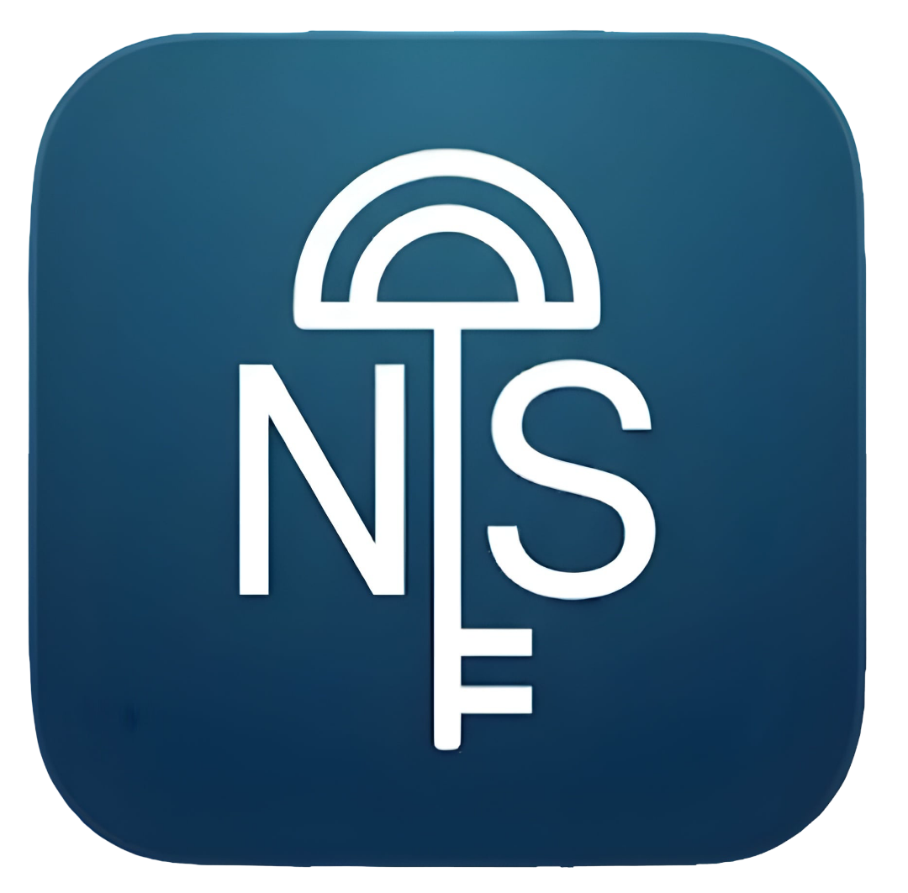

<div align="center">

  

  # 🎮 NIS Digital Store

  **A modern, premium digital storefront application built with Flutter & Supabase**
  
  [](https://flutter.dev)
  [](https://dart.dev)
  [](https://supabase.com)
  [](https://android.com)
  [](LICENSE)

  <p align="center">
    <a href="#-features">Features</a> •
    <a href="#-tech-stack">Tech Stack</a> •
    <a href="#-getting-started">Getting Started</a> •
    <a href="#-environment-setup">Environment Setup</a> •
    <a href="#-building-release-apk">Building Release</a> •
    <a href="#-security">Security</a>
  </p>

</div>

---

## 🌟 Overview

**NIS Digital Store** is a full-featured, state-of-the-art e-commerce mobile application tailored for digital gaming goods, digital subscriptions, in-game currency, and gift cards. Built from the ground up using **Flutter** and powered by a scalable **Supabase** backend, it delivers a high-performance, glassmorphic UI with dynamic ambient lighting, instant authentication, and a complete administrative control panel.

---

## ✨ Key Features

### 🛍️ Customer Experience
* **Ambient Glassmorphic UI:** Deep space dark mode with dynamic blur effects, glowing accent gradients, and smooth page transitions.
* **Smart Catalog & Search:** Real-time search, category filtering (Steam, Discord Nitro, Free Fire, Google Play, etc.), and instant tag sorting.
* **Dual Currency Support:** Seamless currency localization with Bangladeshi Taka (৳ BDT) and US Dollar ($ USD).
* **Shopping Cart & Wishlist:** Real-time price calculation, promo code redemption, and persistent wishlist tracking.
* **Instant Checkout & Tracking:** Manual transaction verification (bKash, Nagad, Rocket, Bank Transfer) with real-time order history updates.

### 🔐 Authentication & Profiles
* **Native Google One-Tap Sign-In:** Frictionless Google Play Services authentication on Android.
* **Manual Email / Password Auth:** Full registration and login workflows with automatic redirect on unrecognized accounts.
* **Profile Management:** Custom avatars, Discord tag integration, phone number verification, and country preferences.

### 🛡️ Administrative Control Suite
* **Real-Time Dashboard:** Overview of total sales, active orders, customer stats, and revenue metrics.
* **Product & Category Management:** Create, edit, and archive products with instant image uploads and tiered stock options.
* **Order Processing:** Review payment transaction IDs, approve orders, and deliver digital keys/codes directly to customers.
* **Custom Payment Gateways & Promo Codes:** Configure custom local payment methods, toggle fee percentages, and create percentage/flat discount codes.

---

## 🛠️ Tech Stack

* **Framework:** [Flutter](https://flutter.dev) (Dart 3.x)
* **Backend & Database:** [Supabase](https://supabase.com) (PostgreSQL, Row-Level Security, Storage, GoTrue Auth)
* **State Management:** [Provider](https://pub.dev/packages/provider)
* **Authentication:** Supabase Auth + [Google Sign-In](https://pub.dev/packages/google_sign_in)
* **Design & Styling:** Custom Vanilla Flutter Theme, Glassmorphism Backdrop Filters, Google Fonts (Outfit & Inter)
* **Caching & Networking:** Cached Network Image with dedicated texture memory guards

---

## 🚀 Getting Started

### Prerequisites
* Flutter SDK (3.13.0 or higher)
* Android SDK & Android Studio (with API 34+ platform tools)
* A [Supabase](https://supabase.com) project with database tables configured

### 1. Clone the Repository
```bash
git clone https://github.com/ImSnigdho/nis_digital_store.git
cd nis_digital_store
```

### 2. Install Dependencies
```bash
flutter pub get
```

---

## 🔑 Environment Setup

This project uses an isolated configuration pattern to keep all sensitive API keys and signing credentials off GitHub.

### Step 1: Configure App Secrets
Copy the environment template file:
```bash
cp lib/config/env.example.dart lib/config/env.dart
```

Open `lib/config/env.dart` and provide your credentials:
```dart
class Env {
  static const String supabaseUrl = 'https://YOUR_PROJECT_ID.supabase.co';
  static const String supabaseAnonKey = 'YOUR_SUPABASE_ANON_KEY';
  static const String googleWebClientId = 'YOUR_GOOGLE_WEB_CLIENT_ID.apps.googleusercontent.com';
}
```
*(Note: `lib/config/env.dart` is in `.gitignore` and will never be committed to Git).*

### Step 2: Configure Android Keystore (Optional for Dev / Required for Release)
Copy the keystore properties template:
```bash
cp android/key.properties.example android/key.properties
```

Edit `android/key.properties`:
```properties
storePassword=YOUR_KEYSTORE_PASSWORD
keyPassword=YOUR_KEY_PASSWORD
keyAlias=YOUR_KEY_ALIAS
storeFile=nis_keystore.jks
```

---

## 📱 Running the App

### Debug Mode
```bash
flutter run
```

### Run with Specific Flavor or Device
```bash
flutter run -d android
```

---

## 📦 Building Production Release APK

To compile an optimized, obfuscated production release APK signed with your release key:

```bash
flutter build apk --release
```

The compiled APK will be output to:
```text
build/app/outputs/flutter-apk/app-release.apk
```

---

## 🔒 Security Highlights

* **Credential Isolation:** No database service keys, anon tokens, or OAuth client secrets are hardcoded in the tracked repository.
* **Keystore Protection:** Release signing keystores and passwords are systematically ignored in `.gitignore`.
* **Zero Risky Permissions:** Only standard network permissions (`INTERNET`, `ACCESS_NETWORK_STATE`) are requested.
* **VirusTotal Verified:** 100% clean detection rating across all 70+ antivirus engines.

---

## 📄 License & Copyright

Copyright © 2026 **Nowrid Ifrad Snigdho**. All Rights Reserved.

This project and its source code are proprietary. Unauthorized copying, modification, redistribution, or publishing of this software under another name is strictly prohibited. See the [LICENSE](LICENSE) file for details.

---

<div align="center">
  <sub>Developed with ❤️ by <b>Nowrid Ifrad Snigdho</b> for <b>NIS Digital Store</b></sub>
</div>
